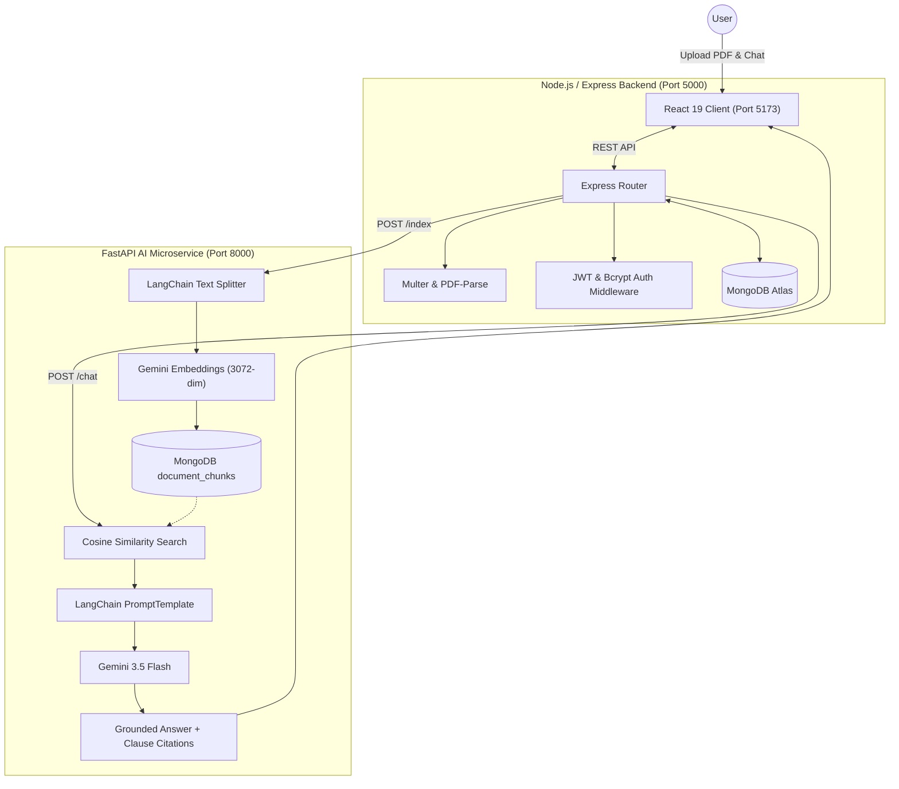

# ⚖️ Clarix — AI-Powered Legal Intelligence & RAG Platform

<div align="center">
  

  <p align="center">
    <strong>An AI-powered legal intelligence platform for analyzing contracts, detecting hidden risks, and grounded RAG question-answering with exact clause citations.</strong>
  </p>

  <p align="center">
    <a href="#" target="_blank">
      
    </a>
  </p>
</div>

---

## 🚀 Overview

Clarix is a full-stack legal intelligence and contract analysis platform designed to turn complex agreements into plain English. Built with **React 19, Node.js, Express.js, MongoDB, FastAPI, LangChain, and Google Gemini AI**, the platform offers:
- Automated legal risk scoring and clause-by-clause breakdowns.
- A **Retrieval-Augmented Generation (RAG)** microservice that chunks multi-page contracts using LangChain and answers contextual user questions with verified clause citations.

---

## ✨ Key Features

* ⚖️ **AI Legal Risk Analysis:** Plain-English contract summaries and 0–10 risk ratings with multi-model fallback.
* 📄 **PDF Processing:** Secure upload and text extraction pipeline with Multer and PDF-Parse.
* ⚠️ **Risk Detection:** Identifies indemnification clauses, liability waivers, non-competes, and unilateral amendment rights.
* 🔍 **RAG Pipeline (LangChain):** Multi-page document chunking using LangChain's `RecursiveCharacterTextSplitter` with sliding-window overlap.
* 🧭 **Vector Semantic Search:** High-density vector embeddings (`gemini-embedding-001`) with cosine similarity retrieval.
* 📚 **Clause Citations:** Cites exact clause segments (e.g., *Clause Segment #2*) in the interactive React chat to eliminate hallucinations.
* 🛡️ **Hardened Security & Rate Limiting:** JWT authentication, Bcrypt password hashing, and two-tier rate limiting verified by Jest unit tests.

---

## 🛠️ Tech Stack

- **Frontend:** React 19, Vite, Vanilla CSS
- **API Gateway / Backend:** Node.js, Express.js
- **AI Microservice:** Python 3, FastAPI, Uvicorn, LangChain
- **LLM & Embeddings:** Google Gemini 3.5 Flash, `gemini-embedding-001`, Groq API (Fallback)
- **Database:** MongoDB Atlas, Mongoose
- **Document Processing:** Multer, PDF-Parse
- **Testing & Security:** Jest, JWT, Bcrypt.js, Express Rate Limit

---

## 📂 System Architecture



---

## 🔑 Environment Variables

### `server/.env`
```env
PORT=5000
CLIENT_URL=http://localhost:5173
MONGO_URI=mongodb+srv://...
JWT_SECRET=your_jwt_secret_here
GEMINI_API_KEY=your_gemini_api_key_here
AI_SERVICE_URL=http://localhost:8000
```

### `ai-service/.env`
```env
PORT=8000
MONGO_URI=mongodb+srv://...
GEMINI_API_KEY=your_gemini_api_key_here
```

---

## ⚙️ Installation & Setup

### 1️⃣ Clone Repository
```bash
git clone https://github.com/Futurater/clarixrag.git
cd clarixrag
```

### 2️⃣ Python AI Microservice (Port 8000)
```bash
cd ai-service
python -m venv venv
# Windows:
.\venv\Scripts\activate
# Linux/macOS:
source venv/bin/activate

pip install -r requirements.txt
python run.py
```
> Interactive API docs available at `http://127.0.0.1:8000/docs`.

### 3️⃣ Node.js Server (Port 5000)
```bash
cd ../server
npm install
npm run dev
```

### 4️⃣ React Frontend (Port 5173)
```bash
cd ../client
npm install
npm run dev
```

---

## 🧪 Running Unit Tests

```bash
cd server
npm test
```
Runs the 16 Jest test suites covering authentication middleware, password hashing hooks, and AI analysis parsing.
